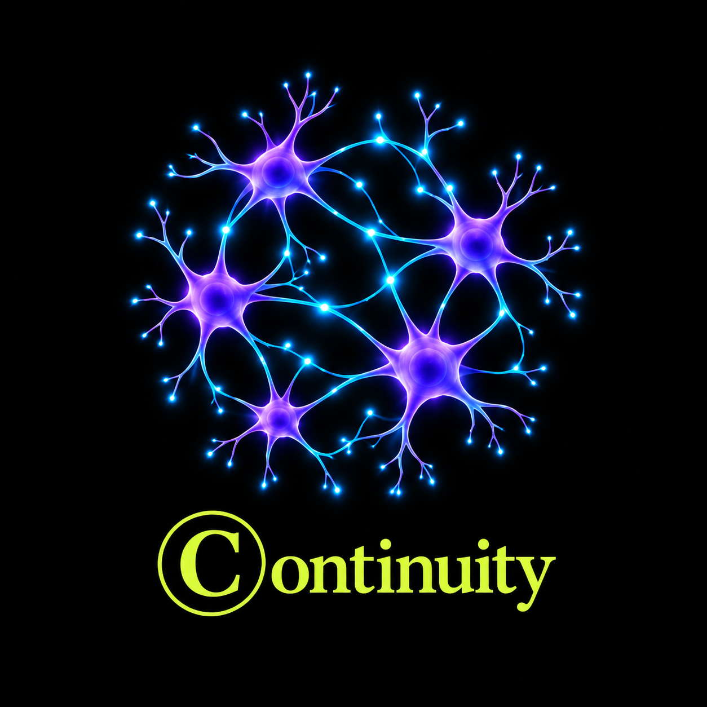

  

# Continuity

**Persistent memory. Adaptive learning. Intelligence that can change without starting over.**

Continuity is the durable cognitive layer around AI: a place for your context, decisions, evidence, and accumulated experience to live beyond any single conversation or model. It brings AI-assisted work into one desktop environment while keeping the history and understanding behind that work under your ownership.

The model supplies intelligence. Continuity supplies the structure that makes that intelligence useful over time.

## Remember the work—and why it mattered

Productive work leaves more than a transcript. It leaves constraints, decisions, discoveries, failed approaches, and reasons for choosing one path over another. Continuity's memory architecture preserves those relationships so future work can build on prior understanding.

Historical significance and present relevance have distinct roles: something can remain worth remembering without needing to influence every conversation.

## Build knowledge from experience

Adaptive learning connects experience to evidence. Continuity's learning model distinguishes observations, hypotheses, lessons, and established conclusions, retaining the provenance and conditions behind them. Later outcomes can reinforce an approach, reveal its limits, or provide grounds to revise it.

The aim is cumulative understanding: knowing what worked, why it worked, and when that knowledge applies again.

## Choose the intelligence that fits

Conversations, agent harnesses, research, and background work belong in a coherent workspace. Continuity's architecture separates those replaceable intelligence surfaces from the durable memory and orchestration layer beneath them.

That separation gives the product its central promise: changing a model or provider should preserve the experience that made your AI useful.

## Keep ownership and control

Your accumulated context and knowledge belong to you. Continuity is designed around authenticated ownership, protected credentials, traceable evidence, and explicit authority for actions affecting your resources. Remembering information, proposing an action, and having permission to execute it remain separate responsibilities.

## Desktop application

The Continuity application brings together an assistant, workload planning, agentic harnesses, repositories, shell and browser tools, provider connections, and encrypted messaging. Its shared foundation is designed to carry context and experience across these surfaces while preserving their individual access and execution boundaries.

## Downloads

Installers and release notes are available on the [Releases page](https://github.com/knightsky-cpu/Continuity-App/releases). Each release identifies its available platforms, installation requirements, and verification status. SHA-256 checksums accompany downloadable installers.

This repository hosts public installers, release information, and branding assets. Application source development is maintained separately.

---

**The intelligence may change. Continuity remains.**
