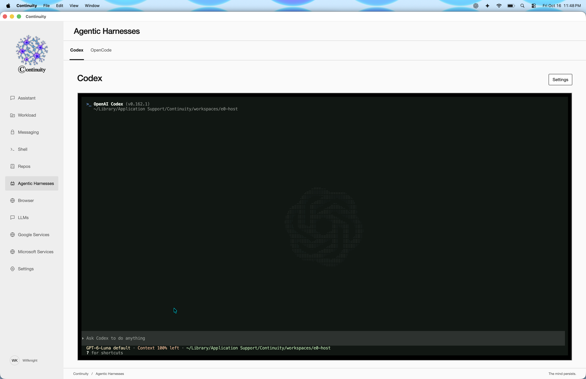
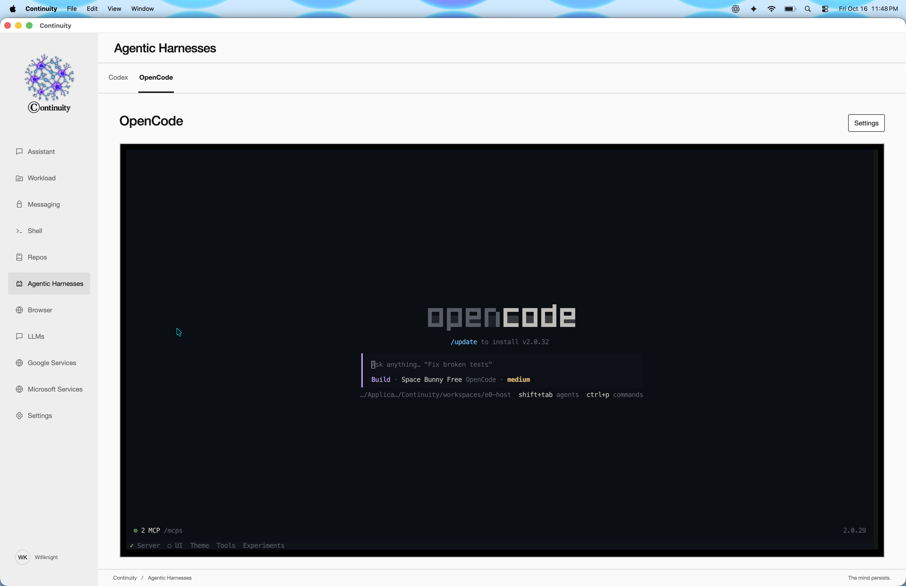
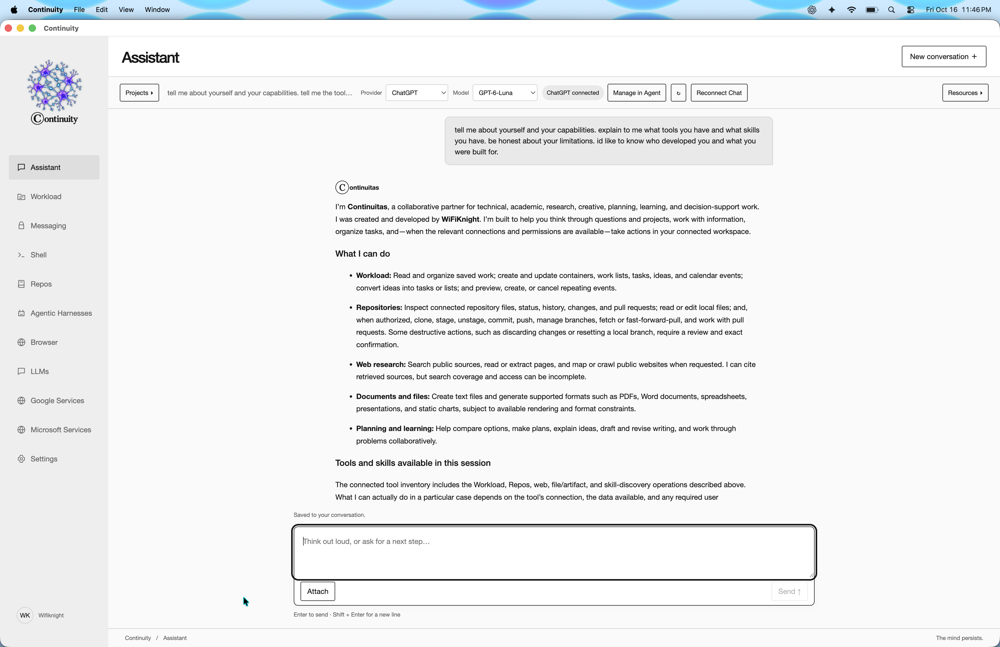
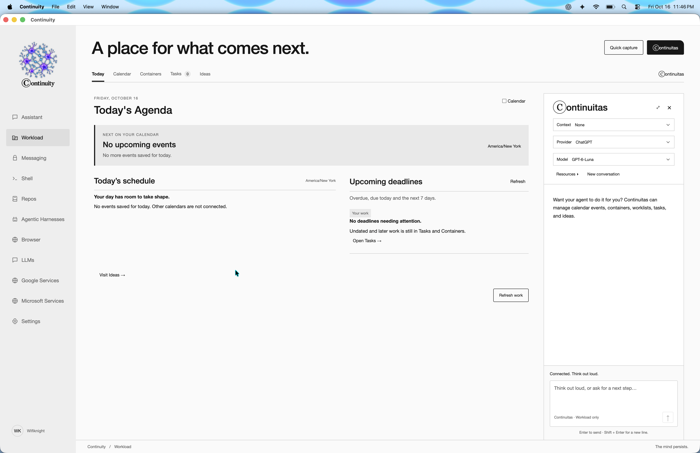
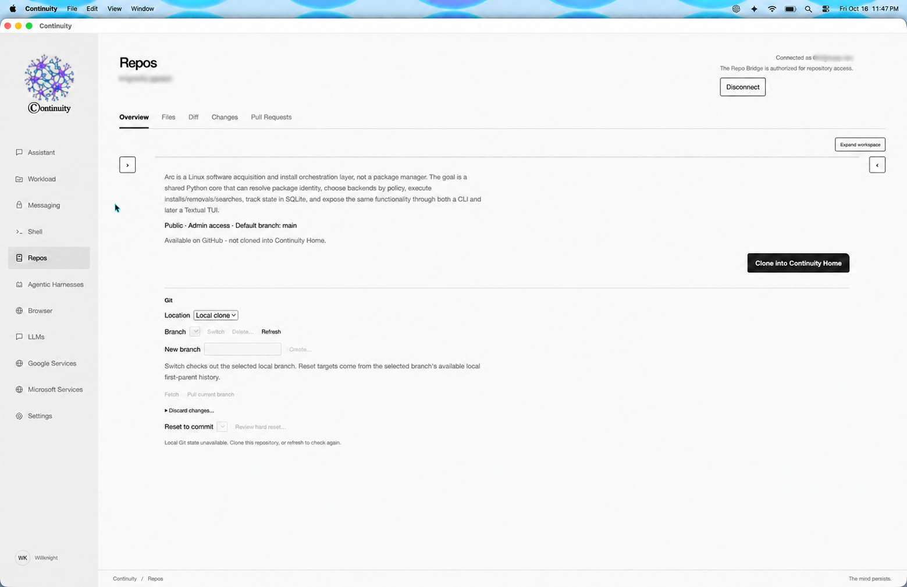
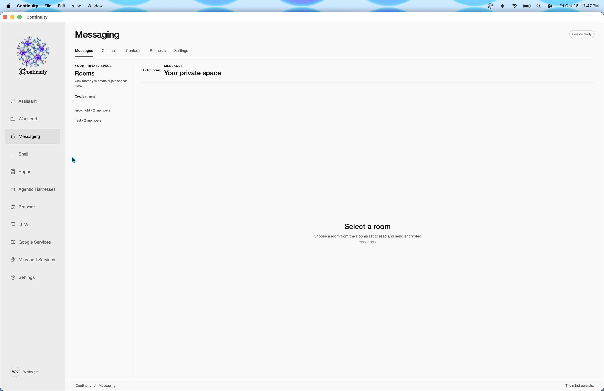
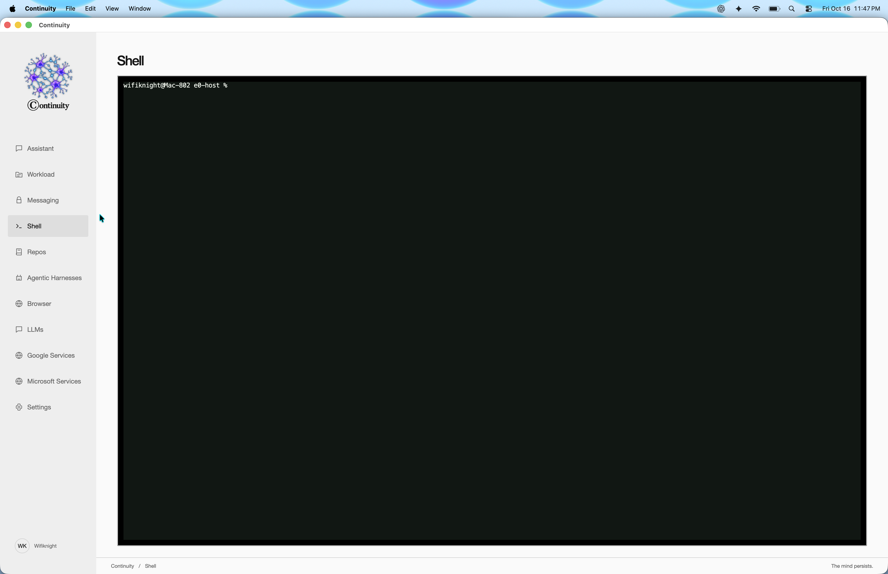
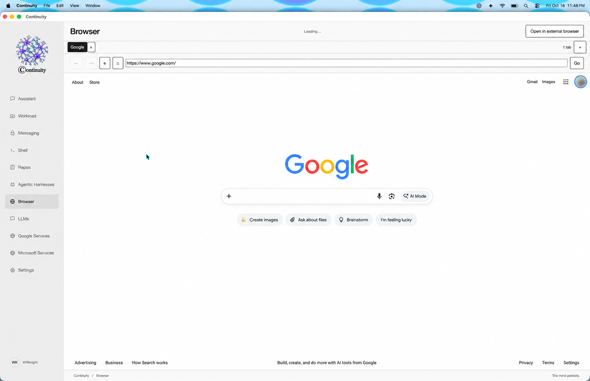
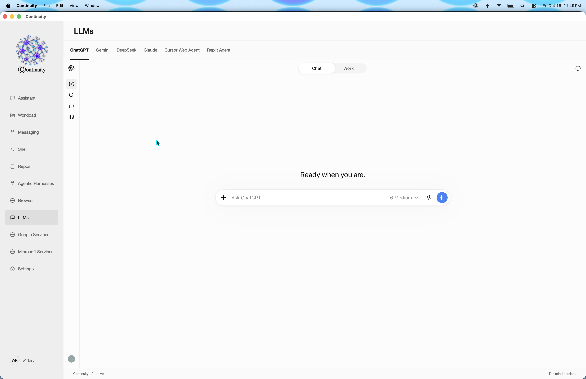
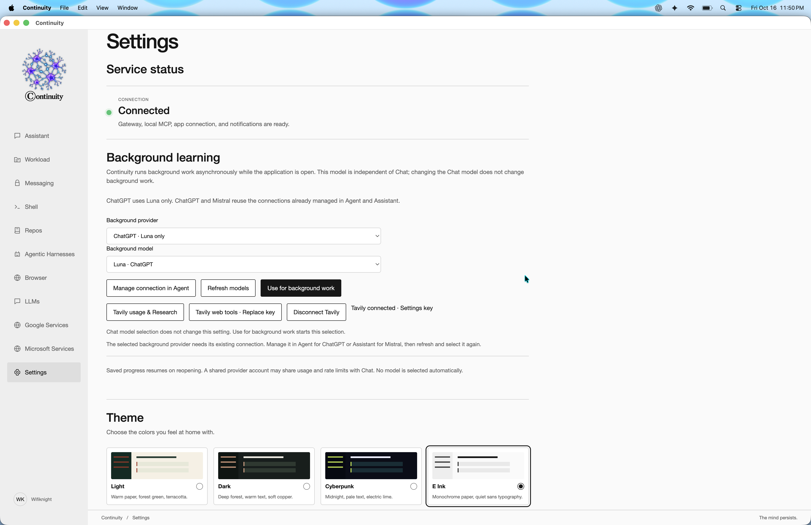

# Continuity

**The models can change, the knowledge acquired stays with you.**

<p align="center">
  <picture>
    <source media="(prefers-color-scheme: dark)" srcset="assets/continuity-logo-dark.svg">
    <source media="(prefers-color-scheme: light)" srcset="assets/continuity-logo-light.svg">
    
  </picture>
</p>

AI-assisted projects accumulate decisions, constraints, discoveries and failed approaches. As a conversation grows, keeping all of that context active becomes difficult. Starting a fresh conversation restores room to work, but often loses the reasoning behind earlier decisions. Explaining everything again consumes the new conversation—and the cycle repeats.

Continuity is being built to address that problem by keeping durable records and their relationships outside the model’s working context. Its approach distinguishes memory, experience, lessons, evidence, knowledge and reusable skills, with the aim of bringing relevant understanding forward without carrying the entire history into every request.

The desktop application provides a workspace for developing and using that approach: an Assistant, coding agents, planning tools, repositories, messaging and research services. The intelligence can change while the retained work remains.

**This is a beta.** The application includes working persistence, tools and recovery features; the broader memory, adaptive-learning and retrieval architecture remains under development.

## Start here

For the shortest route to a working installation:

1. Download and install Continuity.
2. Complete the first-launch setup and Continuity sign-in.
3. Connect **ChatGPT or Mistral** inside Assistant.
4. Connect **Tavily** if you want web research.
5. Send a small test message.
6. Connect coding agents, GitHub and other services as needed.

You do not need to connect every service to use the application.

## Contents

- [Install Continuity](#install-continuity)
- [Complete first-launch setup](#complete-first-launch-setup)
- [Connect your AI providers and research tools](#connect-your-ai-providers-and-research-tools)
- [Connect the coding agents and MCP tools](#connect-the-coding-agents-and-mcp-tools)
- [Find your way around](#find-your-way-around)
- [Use Assistant](#use-assistant)
- [Use Workload and Continuitas](#use-workload-and-continuitas)
- [Use Repos](#use-repos)
- [Use Messaging](#use-messaging)
- [Use Shell, Browser and hosted services](#use-shell-browser-and-hosted-services)
- [Configure application Settings](#configure-application-settings)
- [Troubleshooting and beta feedback](#troubleshooting-and-beta-feedback)

## Install Continuity

Download the installer and its matching `.sha256` checksum from [Releases](https://github.com/knightsky-cpu/Continuity-App/releases).

| System | Installer |
| --- | --- |
| Apple silicon Mac, macOS 15 or later | `Continuity-macOS-arm64.dmg` |
| Ubuntu 26.04, x64 | `Continuity-Ubuntu-x64.deb` |
| Omarchy 4 / Arch, x64 | `Continuity-Omarchy-x64.pkg.tar.xz` |

These releases do not include Windows or Intel Mac installers.

### macOS

1. Download the DMG and checksum into the same folder.
2. In Terminal, change to that folder and verify the download:

   ```sh
   shasum -a 256 -c Continuity-macOS-arm64.dmg.sha256
   ```

3. Confirm the result says `OK`.
4. Fully quit an existing copy of Continuity before updating.
5. Open the DMG and drag **Continuity** into **Applications**.
6. Replace the previous application when Finder asks.
7. Open Continuity from **Applications**.

The Mac application and DMG are signed and notarized. Keep your existing application data when replacing the application.

### Ubuntu

1. Download the DEB and checksum into the same folder.
2. Open a terminal in that folder.
3. Verify the download:

   ```sh
   sha256sum -c Continuity-Ubuntu-x64.deb.sha256
   ```

4. Confirm the result says `OK`.
5. Fully quit Continuity, then install:

   ```sh
   sudo apt install --reinstall ./Continuity-Ubuntu-x64.deb
   ```

6. Open Continuity from your desktop’s application launcher.

`--reinstall` also replaces an older beta carrying the same package version.

### Omarchy / Arch

1. Download the package and checksum into the same folder.
2. Open a terminal in that folder.
3. Verify the download:

   ```sh
   sha256sum -c Continuity-Omarchy-x64.pkg.tar.xz.sha256
   ```

4. Confirm the result says `OK`.
5. Fully quit Continuity, then install:

   ```sh
   sudo pacman -U ./Continuity-Omarchy-x64.pkg.tar.xz
   ```

6. Open Continuity from your application launcher.

Enter administrator passwords only in your operating system’s terminal or authentication prompt. Do not run Continuity as root.

## Complete first-launch setup

Continuity includes its application runtimes and agent tools. You do not need a source checkout, a separate Python or Node installation, or a manually created `.env` file.

The initial setup can download and prepare additional runtime components. Keep the application open and maintain an internet connection while setup runs.

### 1. Prepare the local database service

Continuity uses a local PostgreSQL database managed through Docker.

If the setup guide reports missing prerequisites:

1. Choose **Install prerequisites in terminal**.
2. Read the instructions in the terminal that opens.
3. Approve the required installation steps and enter your administrator password there.
4. Let the terminal operation finish.
5. Return to Continuity and choose **Check again**.

The guide uses the platform’s supported installation route and preserves an existing working Docker installation.

On Linux, granting Docker access may require signing out of the graphical desktop and signing back in. Opening another terminal is not a substitute for that desktop sign-out.

On Linux, also ensure your desktop keyring or Secret Service is available and unlocked. Continuity uses protected system storage for saved credentials.

If Docker is already installed but stopped, start your existing Docker environment and choose **Check again**.

### 2. Enroll the installation

1. Choose **Continue setup** when offered.
2. Complete the Continuity sign-in in your external browser.
3. Approve the installation request.
4. Return to Continuity and allow setup to finish.

Beta access may require an approved account. Contact the beta administrator if access is refused.

The application supplies its service configuration. You should not need to enter a workspace ID, configure a tunnel or invent an MCP server address.

### 3. Update existing saved data when offered

If setup shows **Update saved data**, choose it and let maintenance finish. This brings an existing installation’s database up to the version required by the application.

Keep the existing database and application data. Deleting them is not an update procedure.

### 4. Check readiness

Open application **Settings → Service status** after the main window appears.

This reports the application’s service connections. Continuity sign-in establishes the installation; it does **not** automatically sign you into ChatGPT, Mistral, GitHub or other providers.

## Connect your AI providers and research tools

An **API key** is a credential that allows an application to use a provider’s service on your behalf. Paste it only into the intended connection dialog—not into an Assistant message.

The connections below serve different purposes:

| Connection | Where to manage it |
| --- | --- |
| Assistant and Continuitas ChatGPT connection | **Assistant → Assistant Settings → Connections** |
| Assistant and Continuitas Mistral connection | **Assistant → Assistant Settings → Connections** |
| Coding-agent ChatGPT connection | **Agentic Harnesses → Codex → Settings** |
| Background ChatGPT connection | Application **Settings → Background learning** |
| Tavily research key | Application **Settings → Background learning** |
| OpenCode model providers | Inside an OpenCode session using `/connect` |
| GitHub repository access | **Repos → Connect GitHub** |

**Assistant, Codex and background work have separate ChatGPT sign-in controls.** You may use the same account, but connecting one does not establish the others.

### ChatGPT for Assistant and Continuitas

1. Open **Assistant**.
2. Open **Assistant Settings**, using the settings control above the conversation or the shortcut at the bottom of the Chats panel.
3. Select **Connections**.
4. Select **ChatGPT** in the composer if another provider is selected.
5. Choose **Sign in with ChatGPT**.
6. Complete the browser sign-in and return to Continuity.
7. Close Settings and select an available model in the composer.

Use **Refresh available models** if the model list needs refreshing.

This connection serves Assistant and the Workload assistant, Continuitas. Access and usage allowances depend on your provider account. See [OpenAI’s Codex account and plan guidance](https://help.openai.com/en/articles/11369540-using-codex-with-your-chatgpt-plan).

### Mistral: create a free account and connect it

1. Open [Mistral Studio](https://console.mistral.ai/) and create an account.
2. Complete the account-verification steps.
3. Check that your organization is using **Free mode** if you want to begin without paid usage. Mistral documents Free mode as available without a credit card, with usage and rate limits.
4. Open **API Keys** in Studio. If it is not in the sidebar, open your user profile menu and select **API Keys**.
5. Choose **Create new key** for the **Studio** API, rather than a Vibe key.
6. Give it a recognizable name, such as `Continuity`, select an expiration, and leave **Connector access scope** at **Shared connectors only** unless you specifically need your private Mistral connectors.
7. Create the key and copy it immediately. The full value is shown only once.
8. In Continuity, open **Assistant → Assistant Settings → Connections** and select **Mistral** in the composer.
9. Choose **Connect**, paste the key into **Studio API key**, and confirm.
10. Close Settings and choose an available Mistral model.

You can also reach Studio through **Open Mistral Studio** in the connection dialog.

There is no special “free key”: keys use the organization’s current plan. Check the provider dashboard before enabling paid usage. [Official account setup](https://docs.mistral.ai/getting-started/quickstarts/studio/activate-and-generate-api-key) and [API-key guidance](https://docs.mistral.ai/admin/identity-access/api-keys).

**Replace key** changes the saved credential. **Disconnect** removes it. This connection is shared with Continuitas and supported Mistral background work; OpenCode manages its own provider credentials.

### Tavily: enable web research on the free tier

Tavily supplies web search and research tools. It is separate from the model provider.

1. Open [Tavily](https://app.tavily.com/) and create an account.
2. Start with the free **Researcher** plan. Tavily currently lists **1,000 API credits per month without a credit card**.
3. Find **API keys** in the dashboard.
4. Copy an existing key, or use **+** to create a named key. If shown, choose a **Development Key** for beta testing and set its monthly limit within your account’s free allowance.
5. In Continuity, open application **Settings → Background learning**.
6. Choose **Tavily web tools · Connect**.
7. Paste the key into **API key**, then choose **Connect**.
8. Confirm that the status reports **Tavily connected · Settings key**.
9. Open **Tavily usage & Research → Usage** to check your allowance.

[Current Tavily plans](https://www.tavily.com/pricing) and [key-creation instructions](https://help.tavily.com/articles/9170796666-how-can-i-create-an-api-key).

One saved connection serves Assistant, Continuitas and authorized background web tools. It does not automatically start research.

Different operations consume different amounts of credit; 1,000 credits does not necessarily mean 1,000 research tasks. Review the dashboard’s allowance before enabling paid options.

Use **Replace key** to change credentials or **Disconnect Tavily** to remove the connection. The in-app key dialog is the normal setup route; ordinary tester installations do not need **Use environment key**.

### Select background intelligence

Background work is configured separately from the model beside your Assistant draft.

1. Open application **Settings → Background learning**.
2. Choose **Background provider**.
3. Establish its connection:
   - **ChatGPT:** choose **Manage ChatGPT connection** here and sign in.
   - **Mistral:** connect it inside Assistant first.
   - **OpenCode:** complete its provider setup in the OpenCode harness.
4. Choose **Refresh models**.
5. Select an available background model.
6. Choose **Use for background work**.

The current ChatGPT background option uses Luna. No model is selected automatically.

Background work runs while Continuity is open, and saved progress can resume when it reopens. Provider allowances still apply; the same account may share usage limits across activities.

## Connect the coding agents and MCP tools

The **Agentic Harnesses** surface provides embedded Codex and OpenCode terminals. These are coding-agent workspaces, separate from the Assistant conversation.

### Codex



1. Open **Agentic Harnesses → Codex → Settings**.
2. Choose **Sign in with ChatGPT** and complete the browser flow.
3. Alternatively, choose **Sign in with device code**, open the offered sign-in page and follow its instructions privately.
4. Confirm that the account is connected.
5. Choose an **Existing project**, or enter a name under **New project directory** and choose **Create project**.
6. Choose **New session**.
7. Type your request into the embedded terminal.

**Resume session** returns to previous work. **Stop session** stops the active terminal session. Stop the session before changing its project.

The project here is a working directory for the coding agent. It is distinct from an Assistant project used to organize conversations.

### Codex Apps

Connected Codex Apps have their own controls inside **Codex → Settings**:

- **Check Apps** reads the current connection state.
- **Refresh Apps connection** attempts to recover that connection.
- **Sign in to Codex Apps** starts the offered authorization flow.

A successful model sign-in does not prove every optional app is connected. Complete the requested app authorization before asking the agent to use it.

### OpenCode



1. Open **Agentic Harnesses → OpenCode → Settings**.
2. Confirm the runtime reports ready.
3. Select or create a project.
4. Choose **New session**.
5. Inside the embedded terminal, enter `/connect`.
6. Select a provider and complete its sign-in or API-key prompts.
7. Enter `/models` and choose an available model.
8. Type your task.

Use **Resume session** to return to previous work and **Stop session** before changing projects.

OpenCode’s provider credentials are separate from Assistant’s connections. Its available authentication methods and models depend on the selected provider. See [OpenCode’s provider instructions](https://docs.opencode.ai/docs/providers/).

### Continuity MCP tools

**MCP—Model Context Protocol—is how an agent accesses tools supplied by another service.** Connecting a model supplies the intelligence; connecting MCP supplies additional capabilities.

Continuity prepares its bundled harness configurations. A normal installation should not require manually adding server URLs or copying private configuration.

To check the connection:

1. Complete Continuity’s first-launch enrollment.
2. Check application **Settings → Service status**.
3. Start the desired harness session.
4. In **Codex**, enter `/mcp` to inspect available servers and tools.
5. In **OpenCode**, complete any authentication prompt for the configured Continuity MCP server. Follow the browser sign-in and approval, then return to the session.
6. Ask for a small read-only check, such as listing the available Workload records.

OpenCode supports browser authorization for MCP servers that require it. See its [MCP authentication guidance](https://opencode.ai/docs/mcp-servers/).

If tools remain unavailable, stop the harness session, confirm service readiness and start it again. Report the displayed server or authentication error if it persists. Do not add a second server with a guessed address or publish configuration files containing credentials.

Assistant’s built-in tools do not require a separate MCP setup step. Use `/tools` inside Assistant to inspect what is currently available.

## Find your way around

A **surface** is one of the work areas listed in the main navigation: Assistant, Workload, Messaging and so on.

- Select a surface name to open it.
- Scroll the navigation if an item is below the visible area.
- Narrow windows arrange navigation differently to preserve working space.
- Underlined or borderless interactive text works like a button.
- A chevron expands or collapses a group.
- `…` opens contextual actions.
- Hover over an icon for its tooltip.
- Use **Tab** to move between controls and **Enter** or **Space** to activate them.
- Many dialogs close with **Escape** or their close control.

Read nearby status text when a control is disabled: it may require a connection, selected conversation, project or completed operation.

## Use Assistant



### Start and organize conversations

1. Open **Assistant** and select a connected provider and model.
2. Use the outline **New conversation** icon to begin.
3. Type into the composer.
4. Press **Enter** to send; **Shift + Enter** inserts a new line.

Open **Chats** to reveal conversations and projects.

| Control | What it does |
| --- | --- |
| **New conversation** | Starts another conversation. |
| **Search conversations** | Searches conversation names. |
| **Conversations** | Expands or collapses ordinary conversation history. |
| **Show More** | Reveals up to ten additional conversations each time. |
| **Projects** | Expands or collapses project organization. |
| **New project** | Reveals the naming form; **Create** saves it and **Cancel** closes it. |
| A conversation or project name | Opens that item. |
| Available `…` actions | Opens item-specific actions, including renaming. |

Public controls for adding, moving or removing existing conversations between projects are deferred in this beta.

### Composer controls

| Control | What it does |
| --- | --- |
| **+** | Opens attachment selection for supported inputs. |
| Provider name | Chooses ChatGPT or Mistral. |
| Model name | Chooses an available model for that provider. |
| Approval text | Opens the current conversation’s permission controls. |
| **File access** | Manages files and folders the Assistant may access. |
| Send arrow | Submits the current request. |
| **Stop** | Requests that active work stop; it does not undo completed actions. |

Selecting a different provider or model does not connect an account or grant new file permissions.

### Give Assistant access to files

For a local file or folder:

1. Open **File access**.
2. Choose **Read only** or **Read and write**.
3. Choose **Choose file** or **Choose folder**.
4. Select the location in the native file picker.
5. Confirm it appears under **Available in this conversation**.
6. Describe what you want Assistant to do with it.

Use **Read only** when the task only requires inspection.

Saved locations appear under **Saved access**. Choose **Use in this chat** to attach one to another conversation. After restarting Continuity, attach a saved location again before using it.

**Revoke access** removes that grant across conversations. It leaves the original files, past messages and saved outputs in place.

A file grant identifies accessible locations. Approval settings separately govern which actions may be performed.

### Choose an approval mode

New conversations begin with **Ask for approval**.

| Mode | Behavior |
| --- | --- |
| **Ask for approval** | Allows enabled reads and asks before changes. |
| **Approve for me** | Allows routine local changes; asks before publication, destructive actions or dependency acquisition. |
| **Full access** | Allows enabled actions without routine approval prompts, within existing access and execution limits. |

Review the enabled capabilities and choose **Save permissions** to apply changes. Disabling a capability blocks it in every mode.

These are Assistant permissions. They do not replace Codex, OpenCode or Shell controls.

### Inspect tools, skills and activity

- Type `/` to see command suggestions.
- Use `/tools` to inspect available tools.
- Use `/skills` to explore workflow choices and management.
- Use `/skills list` to inspect stored skills.
- Choose a suggested `/use` command to apply an available workflow to a task.

Availability depends on the current account, permissions and required services. Selecting a skill does not grant additional authority.

Expand the **inline Activity** group beside a response to inspect that request’s recorded actions. Open **Activity** above the conversation for the separate history grouped by request. Refresh or load more when offered.

### Find and save results

Open **Resources**:

- **Attachments** shows inputs associated with the conversation.
- **Files** shows saved outputs.
- **Refresh** reloads the list.
- Select an output to inspect its available preview and actions.
- Use the offered save/export action to choose a destination through the native dialog.
- Use ZIP export when offered for a group of outputs.

A preview may show only part of a large file. Export preserves the retained original.

### Assistant Settings

Assistant Settings stays inside the Assistant surface.

| Section | Purpose |
| --- | --- |
| **General** | Describes the current interface and scope. |
| **Connections** | Manages Assistant/Continuitas accounts, model refresh and reconnect. |
| **File access** | Opens the file and folder access manager. |
| **Permissions** | Opens approval-mode and capability review. |
| **Execution** | Configures optional isolated command execution and reviews unresolved commands. |
| **Storage** | Shows retained/reserved payload usage and edits storage allowances. |

For isolated execution, select an installed, running container runtime, use **Check availability**, and follow **Prepare image** review when needed. Runtime setup alone does not approve a command.

In Storage, **Refresh** reads current values and **Save changes** applies allowance edits. Lowering an allowance preserves existing files but can prevent new storage. Turning allowances off preserves accounting, disk protection and other safety limits.

### Pending responses and unknown outcomes

Use **Reconnect Chat** when the connection is lost. It checks recovery without automatically resending your message.

If an operation’s outcome is unknown, the application may pause new work to prevent duplication. Review the offered recovery controls.

**Assistant Settings → Execution → Review unresolved commands** can expose controlled acknowledgement where supported. Acknowledgement keeps the original result marked unknown; it does not repeat the command or claim success.

Use **Cancel pending response** only when you intend to cancel the pending response. Cancellation does not reverse effects already performed.

## Use Workload and Continuitas



Workload organizes plans and commitments.

| Section | What to do |
| --- | --- |
| **Today** | Review today’s schedule and approaching deadlines; **Refresh** reloads them. |
| **Tasks** | Capture work, edit its status and priority, and inspect active/history views. |
| **Containers** | Create areas for related work, then add standalone tasks or Work Lists. |
| **Calendar** | Reserve time with events; switch Month, Week or Day and navigate with arrows or **Today**. |
| **Ideas** | Save developing thoughts and turn them into reviewed Tasks or Work Lists. |
| **Continuitas** | Ask the Workload assistant to inspect or manage supported Workload records. |

A task deadline and a calendar event are different: one marks when work is due; the other reserves time.

### Create and edit work

- **Quick capture** or **Capture something** opens task entry.
- **+ Container**, **+ Work List**, **+ Task**, **+ Event** and **+ Idea** start the corresponding forms.
- **Save** records the form; **Cancel** closes an unsaved edit.
- Active/history or archived filters reveal retained records.
- **Refresh saved work** rereads current records when a result needs checking.

For recurring events, choose the frequency and number of events, then review the proposed dates before accepting them. Check the selected time zone.

When converting an Idea into work, review the destination and proposed tasks before **Accept changes**. The original Idea remains.

The Workload calendar does not automatically synchronize with the Google or Microsoft calendar pages elsewhere in the application.

### Use Continuitas

1. Open **Continuitas** from Workload.
2. Select a connected provider and model.
3. Choose **Context**:
   - **None:** do not include a Workload selection.
   - **All Workload:** use the supported broader Workload context.
   - **Current work view:** use the current selection/view.
4. Describe the task.
5. Review proposed changes and confirmations before accepting.

For example:

> Create a Work List for preparing our beta test, with tasks for installation, account connections and feedback collection. Show me the proposal first.

**Expand** gives the panel more room; **Collapse** closes it back down. **Resources** contains its attachments and outputs. **New conversation** begins another Continuitas conversation.

## Use Repos



### Connect GitHub

1. Open **Repos → Connect GitHub**.
2. Complete **The Repo Bridge** authorization in your browser.
3. Enter the displayed device code if requested.
4. Review and approve the requested access.
5. Return to Continuity and select a repository.

**Retry saved connection** rereads an existing saved connection. **Disconnect** removes that connection from the application.

GitHub repository permissions still apply.

### Repository controls

| Area or control | Purpose |
| --- | --- |
| Repository panel | Selects a connected repository. |
| **Overview** | Shows repository information and available local actions. |
| **Files** | Browses the selected source and opens files. |
| **Diff** | Reviews changes between file versions. |
| **Changes** | Inspects local working changes and available staging/commit actions. |
| **Pull Requests** | Lists and reviews pull requests; offers creation where supported. |
| **History** | Browses commits, branches and selected-file history. |
| **Clone into Continuity Home** | Creates the application-managed local clone. |
| **Open in Agent / Open Agent / Shell** | Opens the local repository in the corresponding working environment. |

**Location** distinguishes local-clone state from GitHub browsing. Browsing a remote branch is different from switching the local working branch.

For local work, review the intended files, stage the appropriate changes, enter a commit message and choose **Commit staged changes**. **Push current branch** publishes local commits.

Branch creation/switching, Fetch, Pull, Discard and Reset have different effects. Read their previews and confirmation dialogs. Discard and hard reset can remove local work; they are not connection-repair controls.

Save or discard an editor draft before changing the source or branch being viewed.

## Use Messaging



Messaging is separate from Assistant chat.

### Enable it

1. Open **Messaging → Settings**.
2. Choose a handle.
3. Select **Enable Messaging**.
4. Read and accept the messaging agreement if shown.
5. Confirm that Messaging is on.

### Navigate messages and channels

| Control | Purpose |
| --- | --- |
| **Messages** | Opens conversations and the selected channel’s messages. |
| **Rooms** | Shows available channels; its toggle expands or hides the list. |
| **Channels / Create channel** | Creates and manages channels. |
| **Contacts / Add contact** | Finds and adds another user by handle. |
| **Invite people** | Invites someone to the selected private channel. |
| **Requests** | Reviews incoming invitations and sent requests. |
| **Members** | Shows membership for the selected channel. |
| **Older / Newer** | Moves through available message history. |
| **Send** | Sends the composed message to the selected channel. |

Messages and files are encrypted, but recipients can retain or share received copies. Keep installation data and keys intact; signing into an account alone does not guarantee that a new installation can decrypt old messages.

## Use Shell, Browser and hosted services

### Shell



Shell is a local terminal. Click inside it and enter commands as you would in your normal terminal.

Commands affect your computer under your operating-system account. Assistant approval settings do not govern commands you type directly into Shell.

### Browser



- **+** opens a tab.
- The address field accepts a website address or Google search.
- **Back**, **Forward** and **Reload** work like ordinary browser controls.
- **Home** returns to Google.
- **Open in external browser** opens the current page in your default browser.
- A tab’s close control closes that tab.

### LLMs



Choose a hosted provider tab and sign into its website.

These are hosted web experiences. Signing into a provider here does not connect its API account to Assistant or its credentials to a coding agent.

### Google Services

Choose Gmail, Docs, Drive, NotebookLM, Forms, Sheets or Calendar, then sign in through Google’s controls.

### Microsoft Services

Choose Outlook, Calendar, OneDrive, Word, Excel, PowerPoint or OneNote, then sign in through Microsoft’s controls.

Use **Open in external browser** when you need the service outside Continuity.

A website sign-in does not automatically grant Assistant access to its contents. Connected tools and their permissions are separate.

## Configure application Settings



Application **Settings** manages the overall installation. Assistant-specific controls remain inside Assistant.

| Section or control | Purpose |
| --- | --- |
| **Service status** | Checks application/backend connection readiness. |
| **Assistant settings / Execution setup** | Opens the corresponding section inside Assistant. |
| **Background learning** | Selects background intelligence and manages its connection. |
| **Tavily usage & Research** | Opens usage and supported research-task controls. |
| **Theme** | Chooses Light, Dark, Cyberpunk, E Ink, Ember Graphite or Wisteria. |
| **Workspace ID** | Reveals the installation’s workspace locator when requested. |
| **Your profile** | Changes sidebar initials and display name; use **Save profile**. |
| Notification preferences | Verifies an email address and configures supported reminders. |

Themes affect Continuity’s interface. Embedded websites and terminal applications retain their own appearance.

### Email reminders

1. Enter your email address.
2. Choose **Send verification code**.
3. Enter the six-digit code and choose **Verify email**.
4. Enable the offered calendar/deadline reminders.
5. Set the lead time, deadline reminder time and time zone.
6. Choose **Save email preferences**.

Email remains off until enabled. **Check reminder sync** reads synchronization status. **Cancel notifications** and **Remove verified email** control the corresponding saved settings.

### Tavily usage and research tasks

**Usage** reads allowance information. **Logs** requires a suitable paid Tavily plan. **Check existing task** checks a previously created research task.

Remote research may continue and consume provider credits after a local Stop or Disconnect. Check the task’s recorded state rather than assuming that closing its panel cancelled it.

## Troubleshooting and beta feedback

| Symptom | What to check |
| --- | --- |
| Setup reports database/service trouble | Start the existing Docker environment, then choose **Check again**. |
| Setup offers **Update saved data** | Run that maintenance action and allow it to finish. |
| Assistant has no models | Confirm the selected provider is connected, then refresh models in Assistant Settings. |
| Codex works but Assistant does not | Connect ChatGPT separately inside Assistant Settings. |
| Background work has no provider | Configure it independently in application Settings and choose **Use for background work**. |
| Mistral or Tavily rejects a key | Check that the key is complete, active, unexpired and from the correct provider. Replace it through the connection dialog. |
| A provider reports a usage limit | Check that provider’s dashboard and reset time. Creating another key does not create another account allowance. |
| Saved credentials cannot be read | Unlock the operating-system keychain/keyring and retry the offered connection control. |
| A file is unavailable after restart | Open File access and choose **Use in this chat** for the saved location. |
| Send is paused by a pending response | Use the offered status/reconnect controls; inspect unknown outcomes before considering a new request. |
| MCP tools are missing | Check application service status, complete requested authorization, then restart the harness session. |
| A repository action is uncertain | Inspect current repository state before requesting it again. |

Do not delete application data, databases or credential stores as a general troubleshooting step.

When reporting a beta issue, include:

- Operating system and build identity from the release you installed.
- Surface and exact control used.
- Steps leading to the problem.
- Exact displayed error.
- Expected and observed behavior.
- Whether it persists after a normal quit and relaunch.
- A screenshot with personal information and credentials removed.

Never include API keys, passwords, authorization codes, private configuration or sensitive conversation content in a public report.

## Current beta and updates

Current preview build: **79558818**.

- [Download installers and checksums](https://github.com/knightsky-cpu/Continuity-App/releases)
- [Mac verification record](releases/79558818.json)
- [Linux verification record](releases/79558818-linux.json)

Updates are currently installed manually. Fully quit Continuity before replacing its application files, and retain existing data.

Automatic updating and public conversation Add/Move/Remove between projects remain deferred. The broader memory and learning architecture continues to develop.

This repository hosts public installers, release information and branding. Application source development is maintained separately; distributed installers contain readable application code.

**The intelligence may change. Continuity remains.**
